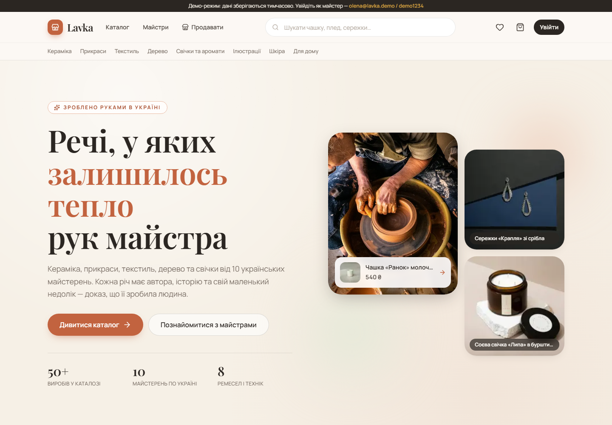
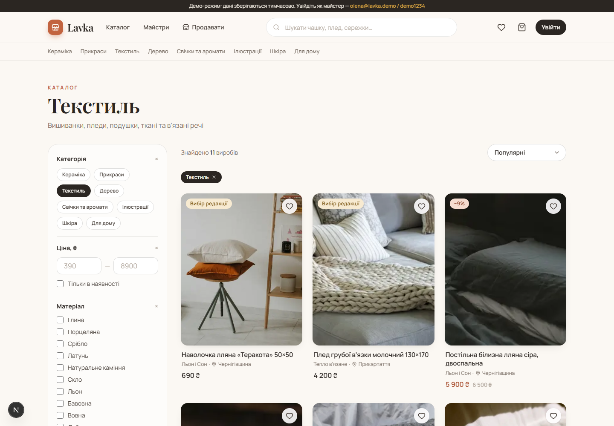
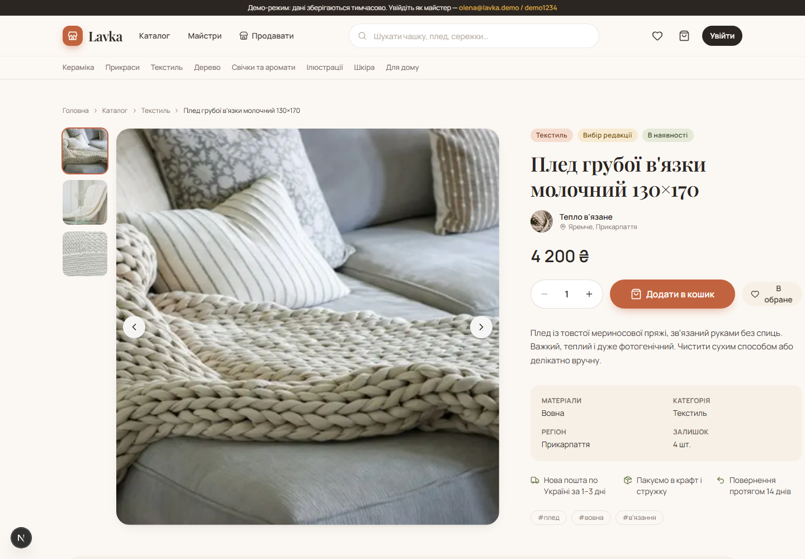
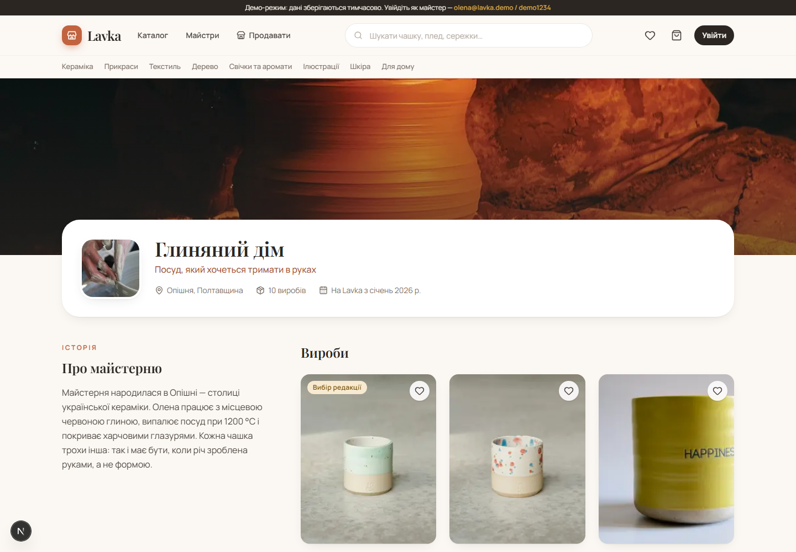
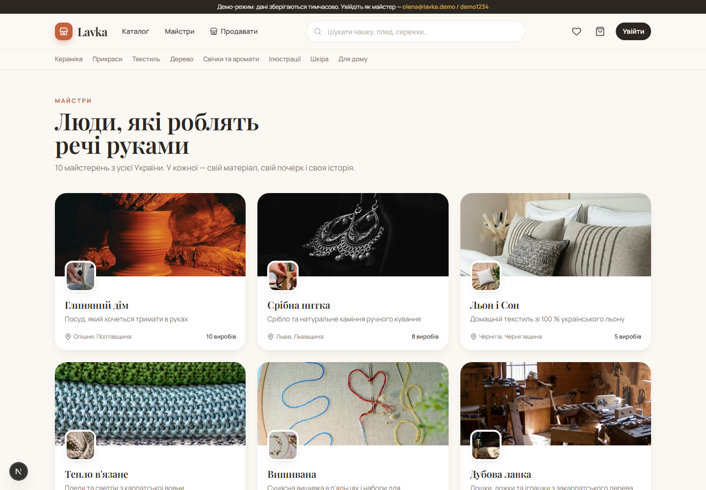

# Lavka — handmade goods marketplace

> A portfolio project: a niche marketplace where Ukrainian makers sell ceramics, jewelry, textiles, woodwork, candles, art and leather goods. UI in Ukrainian, code in English.

**Live demo:** https://lavka-green.vercel.app · **Repository:** https://github.com/ValentynKoval/lavka



## What it does

| Area | Features |
| --- | --- |
| Storefront | Home page with curated picks, collections and featured makers; category tiles; responsive design system built for a "handmade" feel (linen/clay palette, Playfair Display + Manrope). |
| Catalog | Full-text search, filters by category, material, maker region, price range and stock; four sort orders; URL-driven state (shareable links), pagination. |
| Product | Gallery with thumbnails, price with discounts, stock badges, materials/region facts, related products, maker story block. |
| Makers | Public shop page with cover, avatar, story and all products; makers directory. |
| Buyer | Favourites and cart persisted in the browser and synced to the account after sign-in; cart grouped by maker; promo codes; recently viewed products. |
| Checkout & orders | Multi-shop checkout (one order per maker), Nova Poshta delivery form, demo card / cash-on-delivery, atomic `place_order` RPC that validates and decrements stock; order history with status timeline. |
| Reviews | Star ratings with distribution, verified-purchase badge, one review per user per product, ratings on cards and in JSON-LD. |
| Chat | Buyer ↔ maker conversations with Supabase Realtime (polling fallback in demo mode), unread badges, read receipts. |
| Auth | E-mail + password sign-up / sign-in (Supabase Auth), roles buyer / seller / admin with RLS-enforced permissions. |
| Seller cabinet | Shop onboarding, dashboard, product CRUD with multi-image upload, inline stock editing, order management with status transitions, analytics (views, revenue, conversion, top products, status donut) on dependency-free SVG charts. |
| Admin panel | Platform stats and charts, product moderation, hiding shops, role management through the service role. |
| UX extras | ⌘K command palette search, dark mode (token-based, no flash), image zoom on hover, Open Graph images generated per product, sitemap, robots, PWA manifest, Schema.org JSON-LD. |
| Data | Postgres schema with RLS policies, triggers, RPCs and a storage bucket; five migrations in the repo; deterministic seed with 10 shops, 69 products, 126 reviews, 36 orders and chat history. |
| Demo mode | Without Supabase keys the app runs on the same data through an in-memory repository layer, so the UI works anywhere. |

Not included (out of scope for a portfolio): real payments, e-mail notifications, shipping APIs.

## Screenshots

| Catalog with filters | Product page |
| --- | --- |
|  |  |

| Maker shop | Makers directory |
| --- | --- |
|  |  |

## Tech stack

- **Next.js 16** (App Router, React Server Components, Server Actions, `proxy.ts`), **React 19**, **TypeScript** (strict)
- **Tailwind CSS v4** with custom design tokens, **lucide-react** icons
- **Supabase**: Postgres, Auth, Storage, Row Level Security (`@supabase/ssr` for cookie-based sessions)
- **Zustand** (persisted client state), **Zod** (validation)
- **Vitest** for unit tests, **ESLint** (next/core-web-vitals + typescript)
- **Vercel** for hosting

### Architecture notes

```
src/
  app/            routes (home, catalog, product, shop, shops, favorites, cart, checkout, orders, messages, login, register, seller/*, admin/*)
  components/     ui primitives, layout, product, catalog, cart, auth, seller, home sections
  data/           taxonomy (categories, materials, regions) and demo dataset
  lib/
    catalog/      pure filter / sort / pagination / URL-param logic (tested)
    cart/         pure cart math (tested)
    orders/       checkout totals, promo codes, phone normalisation (tested)
    stats/        analytics aggregation and order status machine (tested)
    repositories/ Catalog, Seller, UserData, Auth, Orders, Reviews, Chat, Stats, Admin repositories
      mock/       in-memory implementation on demo data
      supabase/   Postgres implementation
    stores/       Zustand stores (cart, favourites)
    supabase/     server/browser clients, DB row types
supabase/
  migrations/     0001 schema, 0002 RLS, 0003 storage, 0004 commerce (orders, reviews, chat, views), 0005 fixes
  seed.ts         idempotent seed using the service role key
scripts/          demo image downloader, migration runner
```

Pages talk to repository interfaces, never to Supabase directly, so the same screens run on demo data or on a real database.

## Getting started

```bash
git clone https://github.com/ValentynKoval/lavka.git
cd lavka
npm install
cp .env.example .env.local   # leave empty for demo mode
npm run dev                  # http://localhost:3000
```

Demo accounts (demo mode and seeded database), password `demo1234` for all:

| Role | E-mail |
| --- | --- |
| Maker | `olena@lavka.demo` (also `marta@`, `iryna@`, `vasyl@`, `halyna@`, `petro@`, `sofia@`, `andrii@`, `taras@`, `oksana@lavka.demo`) |
| Buyer | `buyer@lavka.demo`, `dmytro@`, `olha@`, `nazar@`, `yulia@lavka.demo` |
| Admin | `admin@lavka.demo` |

Promo codes: `LAVKA10`, `HANDMADE15`, `WELCOME5`.

### Connecting Supabase

1. Create a project at [supabase.com](https://supabase.com) and copy **Project URL**, **anon/publishable key** and **service_role/secret key** into `.env.local` (see `.env.example`).
2. Apply migrations — either paste `supabase/migrations/*.sql` into the SQL editor in order, or set `SUPABASE_DB_PASSWORD` and run:
   ```bash
   npm run db:migrate
   ```
3. Seed demo data (creates confirmed demo users, shops and products):
   ```bash
   npm run db:seed
   ```
4. For a frictionless demo, disable "Confirm email" in Authentication → Providers → Email.

### Scripts

| Command | Purpose |
| --- | --- |
| `npm run dev` / `npm run dev:demo` | Dev server (the latter forces demo data even with keys present) |
| `npm run lint` | ESLint |
| `npm run typecheck` | `next typegen` + `tsc --noEmit` |
| `npm run test` | Vitest unit tests (filters, URL params, cart, checkout, analytics, utils) |
| `npm run build` | Production build |
| `npm run check` | All of the above in sequence |
| `npm run demo:images` | Re-download demo photos from Unsplash into `public/demo` |
| `npm run db:migrate` / `npm run db:seed` | Apply migrations / seed Supabase |
| `node --env-file=.env.local scripts/db-sql.mjs "<sql>"` | Run an ad-hoc SQL statement against the database |

### Environment variables

| Variable | Where used |
| --- | --- |
| `NEXT_PUBLIC_SUPABASE_URL` | client + server |
| `NEXT_PUBLIC_SUPABASE_ANON_KEY` | client + server (publishable key) |
| `SUPABASE_SERVICE_ROLE_KEY` | seed script only (server-side secret) |
| `SUPABASE_DB_PASSWORD` | migration runner only |
| `LAVKA_DATA_SOURCE=demo` | optional, forces demo repositories |
| `NEXT_PUBLIC_SITE_URL` | optional, for Open Graph metadata |

## Credits

Photos: [Unsplash](https://unsplash.com) (Unsplash License). Built with Claude Code.

## License

MIT
